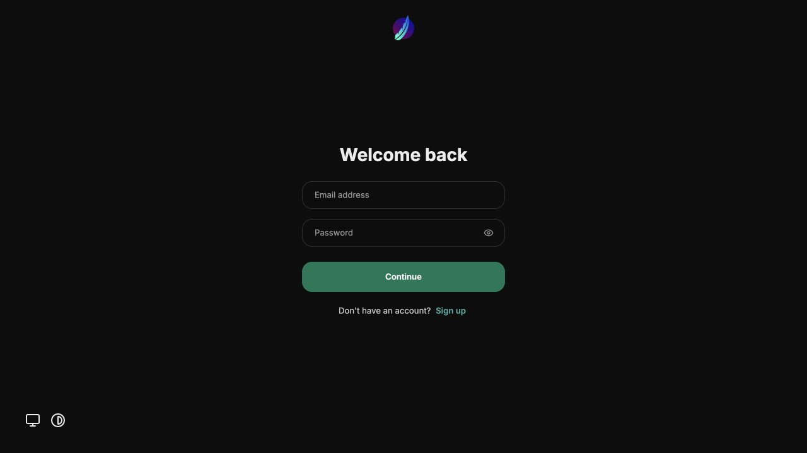
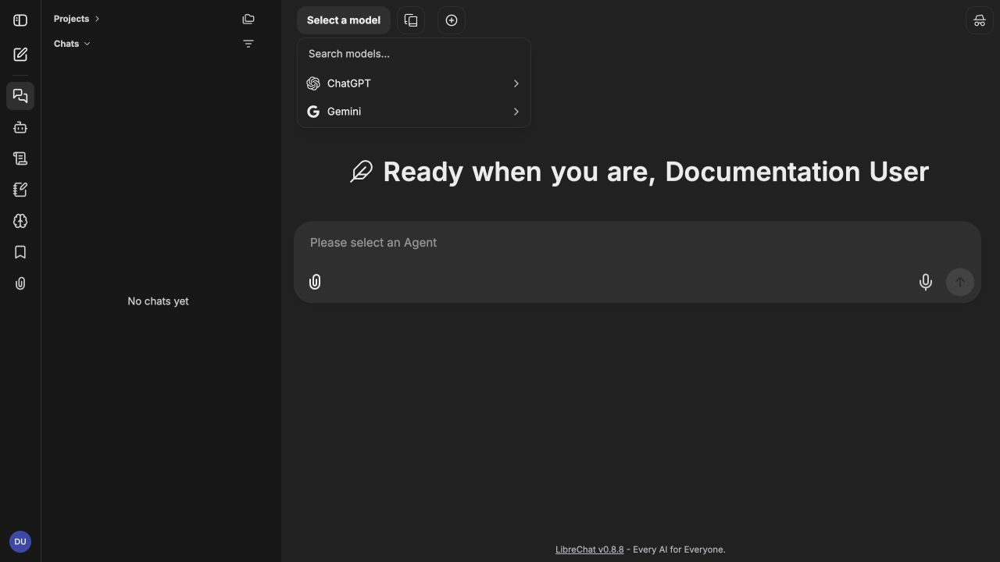

# MCP Chat Tutorial

A runnable tutorial for a multi-provider chat application. LibreChat calls a Python
chat gateway, where the user-selected OpenAI or Google Gemini model can call two
independent Model Context Protocol (MCP) services for live information.

## Architecture

```text
LibreChat (3000) -> OpenAI-compatible adapter -> FastAPI chat gateway (8000)
       |                                             |              |
MongoDB conversations                    OpenAI Chat Completions   Gemini API
                                                     |
                                            streamable HTTP MCP
                                                |          |
                                      Search MCP (8001)  Market MCP (8002)
                                      web search         weather/sports/stocks
```

The folders in `services/` are standalone Python microservices, each with its own
Dockerfile and requirements. The official LibreChat image supplies the web client,
authentication, and conversation persistence; MongoDB stores its application data.

## Client application

LibreChat provides the authentication and account experience for the tutorial
deployment. Create the first local account after starting the Docker stack; there
are no default credentials.



Once signed in, use the model selector at the top of a new conversation to switch
between the **ChatGPT + MCP** and **Gemini + MCP** endpoints and their configured
models. Both endpoints stream through the same Python gateway and can use the MCP
search, weather, sports, and stock tools.



## Code organization

The tutorial uses small objects with explicit responsibilities and keeps framework
entry points as composition roots:

- `services/chat-api/app/providers.py` owns vendor configuration, model allowlists,
  and SDK client creation.
- `services/chat-api/app/mcp_gateway.py` manages MCP connections, discovery, and
  tool invocation.
- `services/chat-api/app/chat_service.py` orchestrates completion and tool-call
  loops without depending on FastAPI routes.
- `services/chat-api/app/streaming.py` encapsulates SSE encoding and incremental
  tool-call reconstruction.
- `services/chat-api/app/openai_compat.py` adapts the tutorial contracts to the
  OpenAI-compatible model and streaming shapes expected by LibreChat.
- Each MCP server delegates transport wrappers to domain service classes in
  `search_service.py` or `live_data_services.py`.
- `librechat.yaml` registers separate ChatGPT and Gemini endpoints, so changing the
  endpoint or model in LibreChat routes the request to the correct vendor.

Constructor injection keeps provider clients and tool gateways replaceable in tests,
while Pydantic models remain the single API contract shared by the route and service
layers.

## Run locally

1. Create an OpenAI API Platform key at <https://platform.openai.com/api-keys>, a
   Gemini key at <https://aistudio.google.com/app/apikey>, or both. Chat product
   subscriptions are not API credentials. Keys remain in the server container.
2. Run `cp .env.example .env`, then set `OPENAI_API_KEY`, `GEMINI_API_KEY`, or both
   in `.env`.
3. Run `docker compose up --build`.
4. Open <http://localhost:3000>, register the first local LibreChat account, and
   select **ChatGPT + MCP** or **Gemini + MCP**. There are no default credentials.
   The API’s interactive documentation is at <http://localhost:8000/docs>.

Try: “What is the weather in Chicago?”, “AAPL stock price”, “NBA scores today”, or
“What happened in AI today?”.

Use `docker compose down` to stop the stack. The public tutorial data sources need no
key but can apply limits; production apps should use licensed providers and caching.

## API example

`POST /v1/chat/completions`

```json
{
  "provider": "gemini",
  "model": "gemini-3.8-flash",
  "stream": true,
  "messages": [{"role": "user", "content": "Weather in Austin?"}]
}
```

Set `stream` to `true` to receive `text/event-stream` events. The gateway emits
`delta` events for incremental text, `tool_call` events after MCP tools complete,
`done` when the response finishes, and `error` if a failure occurs after streaming
has started. Omit `stream` or set it to `false` for the original JSON response.
For Gemini thinking models, the gateway also preserves required
[thought signatures](https://ai.google.dev/gemini-api/docs/thought-signatures)
between streamed function-call rounds without exposing them to the browser.

`GET /v1/models` returns the server-controlled provider/model catalog and whether each
provider is configured. The chat endpoint validates the requested pair, lists tools
from each MCP service, presents them as function tools, executes selected calls, sends
the outputs back to the chosen vendor, then returns or streams its answer.

Model choices can be changed without code by editing the comma-separated
`OPENAI_MODELS` and `GEMINI_MODELS` environment variables. The allow lists prevent a
browser from requesting arbitrary or unexpectedly expensive models.

LibreChat discovers the same allowlisted models through
`GET /v1/compat/{provider}/models` and sends standard Chat Completions requests to
`POST /v1/compat/{provider}/chat/completions`. The adapter returns OpenAI-compatible
JSON or `data:` streaming chunks while the gateway handles MCP calls internally.

## Build individual services

```bash
docker build -t tutorial-search ./services/mcp-search
docker run --rm -p 8001:8001 tutorial-search

docker compose pull librechat
docker compose up librechat mongodb
```

## Security checklist

- Keep `OPENAI_API_KEY` and `GEMINI_API_KEY` in `.env` or a secret manager, never in
  `librechat.yaml`, `.env.example`, or Git.
- Set `LIBRECHAT_ALLOW_REGISTRATION=false` after creating the intended local
  accounts, especially before exposing the stack outside localhost.
- Add authentication, rate limits, audit logs, and request limits before production.
- Search snippets are untrusted reference data, never instructions for the model.

The gateway uses the OpenAI Python client for both vendors. OpenAI supports function
tools through [Chat Completions](https://developers.openai.com/api/reference/python/resources/chat/subresources/completions/methods/create),
and Google documents the same client shape through its [OpenAI compatibility endpoint](https://ai.google.dev/gemini-api/docs/openai).
